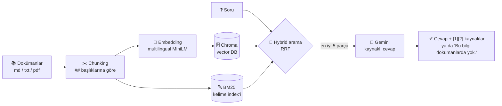

# rag-from-scratch

Şirket dokümanları üzerinde soru-cevap yapan, **her cevabı kaynağıyla veren** ve cevabı bilmediğinde
**uydurmak yerine "bilmiyorum" diyen** bir RAG (Retrieval-Augmented Generation) sistemi.
Framework kullanmadan, her adımı ayrı bir modül olarak sıfırdan yazıldı ve 40 soruluk bir test setiyle ölçüldü.

```
❓ Evlendiğimde kaç gün izin alırım?

💬 Evlendiğinizde 5 iş günü ücretli mazeret izni alırsınız [5]. Ayrıca evlenen
   çalışanlara 5.000 TL hediye çeki verilir [2].

📎 [2] 08-yan-haklar.md › Özel günler
   [5] 02-izin-politikasi.md › Mazeret izinleri
```

## Mimari



| Adım | Modül | Ne yapıyor? |
|---|---|---|
| Yükleme | `rag/loader.py` | Dosyaları `Document(text, metadata)` yapısına çevirir; PDF'te her sayfa ayrı, sayfa numarasıyla |
| Chunking | `rag/chunker.py` | İki yöntem: sabit boyutlu (500/50) ve `##` başlıklarına + paragraflara göre |
| Embedding | `rag/embedder.py` | `paraphrase-multilingual-MiniLM-L12-v2` ile 384 boyutlu vektörler (yerel, ücretsiz) |
| Arama | `rag/search.py` | Chroma (vektör) + BM25 (kelime, Türkçe için 5 harflik kök) + RRF ile hybrid |
| Cevap | `rag/pipeline.py` | Numaralı kaynaklarla prompt → Gemini → `[n]` atıflarını ayıkla |
| LLM | `rag/llm.py` | Gemini istemcisi; 429/503 hatalarında exponential backoff ile yeniden dener |
| Ölçüm | `rag/testset.py`, `rag/evaluate.py` | Test seti doğrulama, recall@5, LLM-as-a-judge ile doğruluk ve sadakat |

## Veri ve test seti

- **Veri:** Kurgusal bir yazılım şirketinin ("Mavikod Teknoloji") 8 dokümanlık çalışan el kitabı (~3.600 kelime).
  Kurgusal olmasının sebebi: LLM bu bilgileri eğitimden **bilemez**. Doğru cevap ancak retrieval sayesinde gelebilir.
- **Test seti:** 40 soru, 4 tür: `basit` (23), `birlestirme` — cevap iki ayrı bölümde (7), `hileli` — yanlış
  varsayım içeren (4), `yok` — cevabı dokümanlarda olmayan (6). Her sorunun altın cevabı, anahtar ifadeleri ve
  kaynağı var. Test setinin kendisi de otomatik doğrulanıyor (bu doğrulama yazdığım bir hatayı yakaladı).

## Sonuçlar

### Retrieval: doğru bölüm ilk 5 sonuçta mı? (recall@5, 34 soru)

| Yöntem | basit | birleştirme | hileli | **Toplam** |
|---|---|---|---|---|
| Vektör | 91% | 86% | 100% | 91% |
| Kelime (BM25) | 100% | 93% | 100% | **99%** |
| Hybrid (RRF) | 100% | 86% | 100% | 97% |

### Cevap kalitesi: chunking deneyi (40 soru, aynı test seti, hybrid arama)

| Metrik | Başlığa göre | Sabit (500/50) |
|---|---|---|
| **Doğruluk** (LLM hakem) | **92%** | 90% |
| Doğruluk (anahtar ifade kontrolü) | **95%** | 88% |
| Sadakat / faithfulness (uydurma yok) | 100% | 100% |
| Kaynak gösterme | **97%** | 88% |
| Cevapsız sorularda "bilmiyorum" deme | 100% | 100% |
| Birleştirme soruları | 71% | **86%** |
| Hileli sorular | **75%** | 50% |

Ayrıntılı, soru soru sonuçlar: [`sonuclar/baslik.json`](sonuclar/baslik.json), [`sonuclar/sabit.json`](sonuclar/sabit.json)

## Çalıştır

Gereksinimler: Python 3.12, ücretsiz bir [Gemini API anahtarı](https://aistudio.google.com/apikey).

```bash
git clone https://github.com/EnesKss/rag-from-scratch.git
cd rag-from-scratch
python -m venv .venv
.venv\Scripts\activate            # macOS/Linux: source .venv/bin/activate
pip install -r requirements.txt
copy .env.example .env            # macOS/Linux: cp .env.example .env  → içine anahtarını yaz
```

```bash
python sor.py "Yıllık izin kaç gün?"     # tek soru
python sor.py                            # sohbet modu
python ders06_testset.py                 # retrieval ölçümü (LLM'siz, ücretsiz)
python ders07_olcum.py                   # cevap kalitesi ölçümü (~20 dk, ücretsiz API sınırları yüzünden)
pytest                                   # 53 test (LLM taklit edilir, API anahtarı gerekmez)
```

İlk çalıştırmada embedding modeli (~470 MB) bir kez indirilir.

## Öğrendiklerim

- **Sabit chunking her zaman kötü değil.** "450 TL" gibi bilgilerde konuları karıştırıp embedding'i
  bulanıklaştırıyor (aynı bilgi temiz parçada 0.63, karışık parçada 0.47 benzerlik aldı). Ama birleştirme
  sorularında komşu bölümleri tesadüfen aynı parçaya koyduğu için **15 puan daha iyi**. Bunu ancak ölçünce gördüm.
- **Hybrid otomatik olarak en iyisi değil.** Bu veride, Türkçe için ilk 5 harfi kök sayan basit bir BM25,
  küçük çok dilli embedding modelinden daha iyi; RRF bazen zayıf listenin etkisiyle doğru parçayı aşağı itiyor.
- **Az soruyla karar verme.** 6 soruluk ilk denemede vektör araması 6'nın 4'ünde kaçırıyor gibi görünüyordu;
  34 soruda recall'ı %91 çıktı.
- **Hatanın nereden geldiğini ayır.** Birleştirme sorularındaki hatalar retrieval'dan (ikinci bölüm bulunamıyor),
  hileli sorulardaki hata ise prompt'tan geliyor ("25 gün, değil mi?" → model düzeltmek yerine "bilgi yok" diyor).
- **Sabit bir "bilmiyorum" cümlesi** istemek, reddetmeyi kodla ölçülebilir kılıyor.

## Sınırlamalar

- Hakem LLM, cevabı yazan modelle aynı (`gemini-3.5-flash-lite`); kendi cevabını kayırabilir. Bu yüzden
  yanında kural tabanlı anahtar ifade kontrolü de raporlanıyor.
- 40 soru küçük bir set: %2'lik fark tek bir soruya denk geliyor. LLM cevapları her çalıştırmada birebir
  aynı olmadığı için skorlar birkaç puan oynayabilir.
- Dokümanlar kurgusal ve temiz Markdown; gerçek PDF'ler daha dağınık olur.

## Sonraki adımlar

- [ ] Prompt'a "yanlış varsayımı kaynaklara göre düzelt" kuralı ekleyip hileli soruları tekrar ölçmek
- [ ] k=5 → k=8 ve "contextual chunking" ile birleştirme sorularını iyileştirmek
- [ ] FastAPI ile API + Docker ile tek komutla çalıştırma

## Proje yapısı

```
rag/            sistemin modülleri (loader, chunker, embedder, search, llm, pipeline, testset, evaluate)
data/raw/       kurgusal şirket dokümanları
data/testset.jsonl   40 soruluk test seti
tests/          53 birim testi
dersler/        her adımın öğrenme notları (Türkçe) + rehber.html: quizli etkileşimli çalışma rehberi
ders01..07_*.py her adımı adım adım gösteren betikler
sonuclar/       ölçüm sonuçları
sor.py          soru-cevap arayüzü
```

Bu proje, [Mehmet Fatih Önkol](https://instagram.com/thefatihonkol)'un "3 AI Projesi" rehberindeki ilk projedir.
